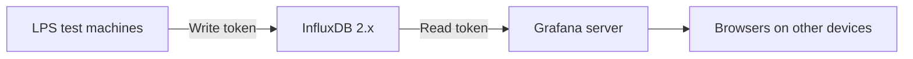

# Integrating LPS with Grafana

LPS exports test metrics to InfluxDB. Grafana reads those metrics and displays
the six linked dashboards provided in [resources](resources/).

> **Version compatibility:** These templates apply to the current LPS preview
> release, **3.0.6.82-preview**. Earlier versions may not export all metrics
> required by these dashboards.



The JSON templates contain dashboard definitions and Flux queries, not passwords
or historical test data. Importing them does not create an InfluxDB bucket or
enable metrics export in LPS. A fresh database remains empty until LPS publishes
a run or the verification script writes its explicitly named fixtures.

## Dashboard Templates

Import all six files. Their links preserve the selected run, round, iteration,
target, and time range.

| Template | Contents |
| --- | --- |
| [Requests](resources/lps-requests.json) | Request counts, rate, concurrency, traffic activity, and watchdog intervals |
| [Latency](resources/lps-latency.json) | Windowed and cumulative response times, percentiles, and timing breakdown |
| [Server Latency](resources/lps-server.json) | Server processing time and database, cache, and application components |
| [Data Transfer](resources/lps-transfer.json) | Bytes sent and received, windowed bandwidth, and cumulative average bandwidth |
| [Responses](resources/lps-responses.json) | HTTP status codes, distribution, and totals |
| [Performance Report](resources/lps-report.json) | Timing, request, and transfer summary tables |

Each view includes common summary tiles. The templates use Grafana's built-in
panels and InfluxDB data source; no additional panel plugins are needed.

## Import into an Existing Grafana Server

### 1. Prepare InfluxDB

Use **InfluxDB 2.x with Flux support**. These templates are not SQL or InfluxQL
dashboards. They were tested with **InfluxDB 2.7 and Grafana 12.3.1**.

Create an organization and bucket, or use existing ones. The defaults are `LPS`
and `LPS_Metrics`. Create separate bucket-scoped tokens:

- **Write token:** used by LPS to publish metrics.
- **Read token:** used by Grafana to query metrics.

Keep tokens private. Do not embed them in dashboard JSON or commit them to Git.

### 2. Add the Grafana Data Source

In Grafana, open **Connections > Data sources > Add data source > InfluxDB**.
Configure:

| Setting | Value |
| --- | --- |
| Query language | `Flux` |
| URL | InfluxDB address reachable from the Grafana server |
| Organization | Your InfluxDB organization, such as `LPS` |
| Token | The bucket-scoped read token |
| Default bucket | Your metrics bucket, such as `LPS_Metrics` |

Choose **Save & test**. The URL must be reachable from Grafana itself, not just
your browser. For containers, `localhost` refers to the container. The bundled
Compose setup uses `http://influxdb:8086` between its services.

### 3. Import the Templates

1. Open **Dashboards > Import** and upload each JSON from the template table.
2. Keep the supplied dashboard UIDs (`lps-requests`, `lps-latency`, `lps-server`,
   `lps-transfer`, `lps-responses`, and `lps-report`). The navigation links use
   these UIDs. Changing a UID requires updating the links in all six templates.
3. If a UID already exists, replace it only when updating that LPS dashboard;
   back up any local customizations first.
4. Open **LPS / Requests** and select your InfluxDB **Data source** and **Bucket**
   in the dashboard filters. The default data source UID is `lps-influxdb`, but
   the selector lets you choose your existing Flux data source.

### 4. Configure LPS and Run a Test

Enable InfluxDB export in LPS Settings, or use the CLI. Replace the placeholders
with your connection details and enter the write token locally:

```powershell
lps influxdb -ie true -iu "http://INFLUX_HOST:8086" -it "<BUCKET_WRITE_TOKEN>" -io "<ORGANIZATION>" -ib "<BUCKET>"
```

Use the URL and published port reachable from the **LPS machine**. The bundled
local stack uses `http://127.0.0.1:8087` for an LPS process on the same host.
Configure each independent test machine that publishes metrics. Saved settings
apply to future runs; an already-running test keeps its existing configuration.

Run your normal plan, or send 60 requests to your own test API after replacing
this example URL:

```powershell
lps --url "http://localhost:5000/your-endpoint" -rc 60
```

In Grafana, choose **Last 15 minutes**, refresh the dashboard, and select the new
**Run**, **Round**, **Iteration**, and **Target**. Use a wider time range for older
runs. Node.js is not required for manual template imports or LPS metrics export.

## Start a Separate Local Stack

For a new installation, keep [grafana](grafana/) and [resources](resources/) as
sibling folders. Copy both folders, but exclude the generated `grafana/.env`
credentials and `grafana/.local` verification artifacts. Start with fresh Docker
volumes; copying templates alone does not migrate an existing database.

Install Docker with Compose and Node.js 22.12 or later. From the **lps-docs
directory**, run:

```powershell
docker pull influxdb:2.7
docker pull grafana/grafana:latest
node grafana/start-local.mjs
```

The startup script rebuilds the templates, provisions both services, and imports
all six dashboards. It uses installed images without pulling them automatically.
The Compose file currently references the `latest` Grafana tag; pin a tested
version and pull that tag when reproducible deployments are required.

| Service | Local connection |
| --- | --- |
| Grafana | http://127.0.0.1:3300/d/lps-requests |
| InfluxDB | http://127.0.0.1:8087 |
| Organization | `LPS` |
| Bucket | `LPS_Metrics` |

Credentials are generated in the Git-ignored `grafana/.env` file. Admin username
is `lps`; password keys are `LPS_GRAFANA_PASSWORD` and `LPS_INFLUX_PASSWORD`.
`LPS_INFLUX_WRITE_TOKEN` is the LPS export token; `LPS_INFLUX_READ_TOKEN` is used
by Grafana. Enter the write token in LPS Settings, or configure it from PowerShell
without displaying it. Run this from the **lps-docs directory**:

```powershell
$writeToken = node --env-file=./grafana/.env -p "process.env.LPS_INFLUX_WRITE_TOKEN || ''"
if ($LASTEXITCODE -eq 0 -and $writeToken) {
    lps influxdb -ie true -iu "http://127.0.0.1:8087" -it "$writeToken" -io "LPS" -ib "LPS_Metrics"
} else {
    throw "Could not load the InfluxDB write token."
}
```

The local stack uses separate `lps-grafana` containers and named volumes, with
seven-day data retention. Preserve its credentials with its volumes. Do not
regenerate credentials against already-initialized volumes. Provisioned
dashboards are file-managed; regenerate the resources for persistent changes.

## Share One Server across Devices

For a team, use one InfluxDB and Grafana server. LPS machines publish to that
server, and users view Grafana through their browsers. Viewing devices need no
Docker installation, LPS installation, or imported templates of their own.

The bundled stack deliberately binds both ports to `127.0.0.1` and enables
anonymous Grafana viewing for local use only. Before allowing LAN access:

1. In [compose.yaml](grafana/compose.yaml), replace the localhost bindings with
   the server's trusted LAN address. For example, use `192.168.1.50:3300:3000`
   for Grafana and `192.168.1.50:8087:8086` for InfluxDB.
2. Set `GF_AUTH_ANONYMOUS_ENABLED` to `"false"`, use strong credentials, and
   grant viewers only the access they need.
3. Restrict firewall access to trusted devices. Use HTTPS or a trusted VPN for
   traffic crossing untrusted networks, and do not expose these ports publicly.
4. Apply the Compose changes during a suitable maintenance window. Recreating
   services can briefly interrupt dashboards and metrics writes; do not do it
   in the middle of an important test.
5. Configure remote LPS machines with `http://192.168.1.50:8087` (or the secured
   InfluxDB URL). Open `http://192.168.1.50:3300/d/lps-requests` in browsers.

Replace the example address with your server's address. An LPS process inside
a container also needs a network-reachable address, not its own localhost.

## Reading the Dashboards

- Select one endpoint within a run, round, and iteration. Exact host-wide
  percentiles are not available in the current LPS InfluxDB export and are not
  approximated by averaging endpoint percentiles.
- Summary counters use the latest cumulative snapshot in the time range,
  not a sum of repeated snapshots. Error percentage is derived from counters.
- Windowed metrics may store only the target origin while cumulative metrics
  store the full URL. Queries account for both while retaining the run, round,
  and iteration filters; they cannot recover endpoint distinctions not exported.
- Watchdog cooling appears as orange intervals. Hover the thin orange strip at
  the bottom of an interval for its times, machine, node, and reason. Duration
  is available in the **Watchdog intervals** table. Batch cooldowns are hidden.
- Server Latency panels require server-timing headers and matching LPS parsing
  configuration. Older LPS versions may not export every measurement used here.
- Missing data stays missing. **Not finalized** means no final status was found
  for that selection and time range; the test may still be running.

## Troubleshooting and Verification

| Symptom | Check |
| --- | --- |
| No runs or no data | Enable export before a new run; check data source, bucket, filters, and time range |
| Unauthorized or forbidden | Check token organization, bucket scope, and read/write permissions |
| Connection refused | Check the address from the Grafana or LPS host; container localhost is not the host machine |
| Linked view is missing | Import all six files and preserve their UIDs |
| Server Latency is empty | Check server-timing response headers and LPS parsing settings |
| Metrics disappeared | Check retention and time range; the bundled bucket retains seven days |

To rebuild and validate the distributed JSON, run from **lps-docs**:

```powershell
node grafana/build-dashboard.mjs
node --test grafana/dashboard.test.mjs
```

The tests check that all six resource files match the generator, share selectors
and navigation, and retain the expected query and layout semantics. Re-import
changed JSON into a manually managed Grafana installation. For the local stack,
rerun `node grafana/start-local.mjs` to regenerate and reload provisioning;
changed Compose mounts may require recreating the Grafana container.

For fixture checks, an optional real loopback test, and the measurement schema,
see [InfluxDB setup and metrics reference](grafana/setup%20influxDB.md).